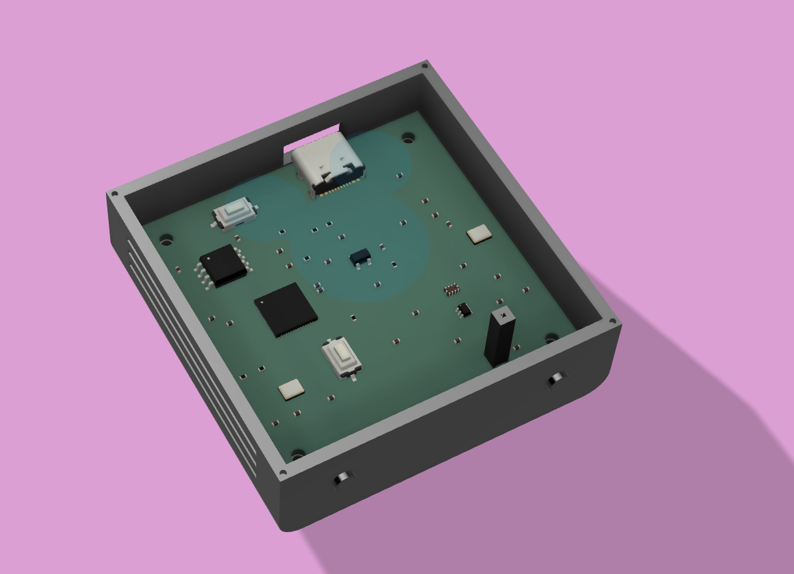
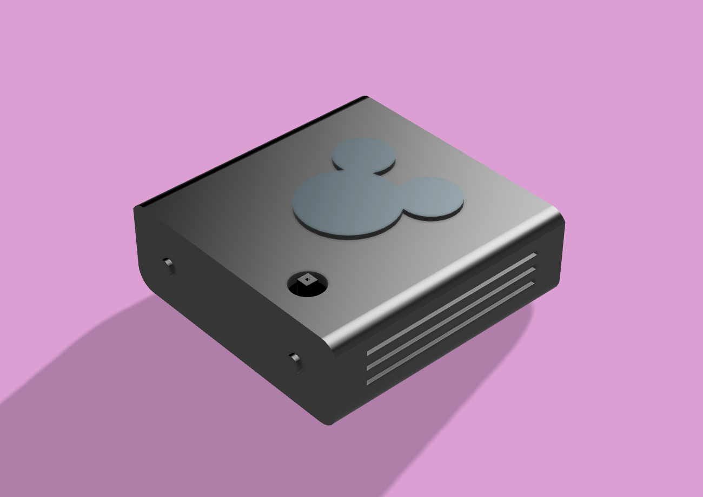
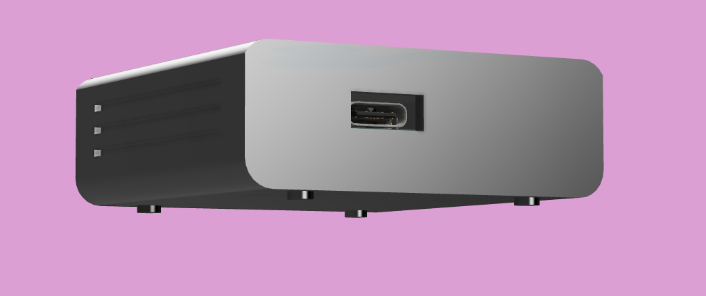
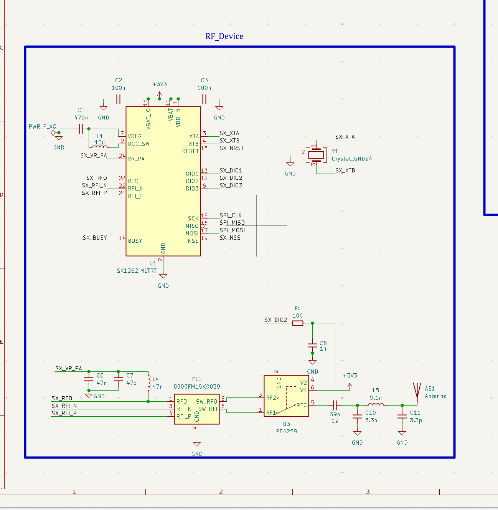
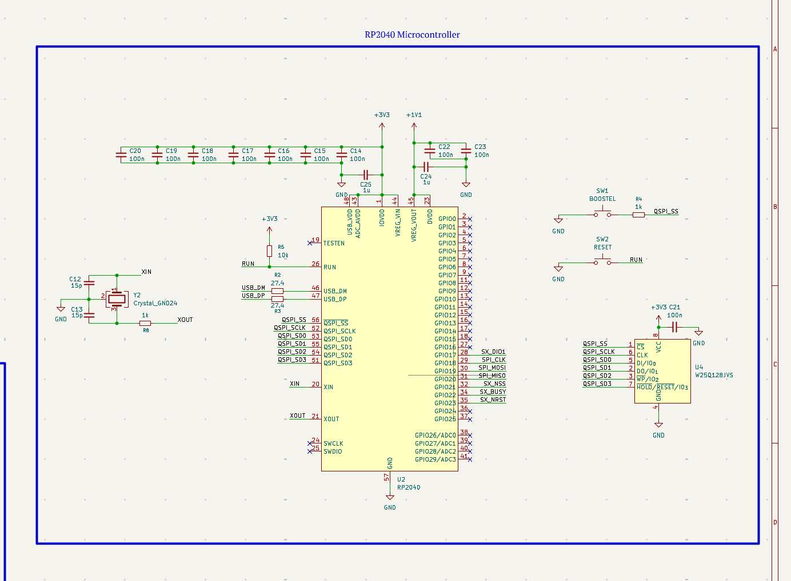
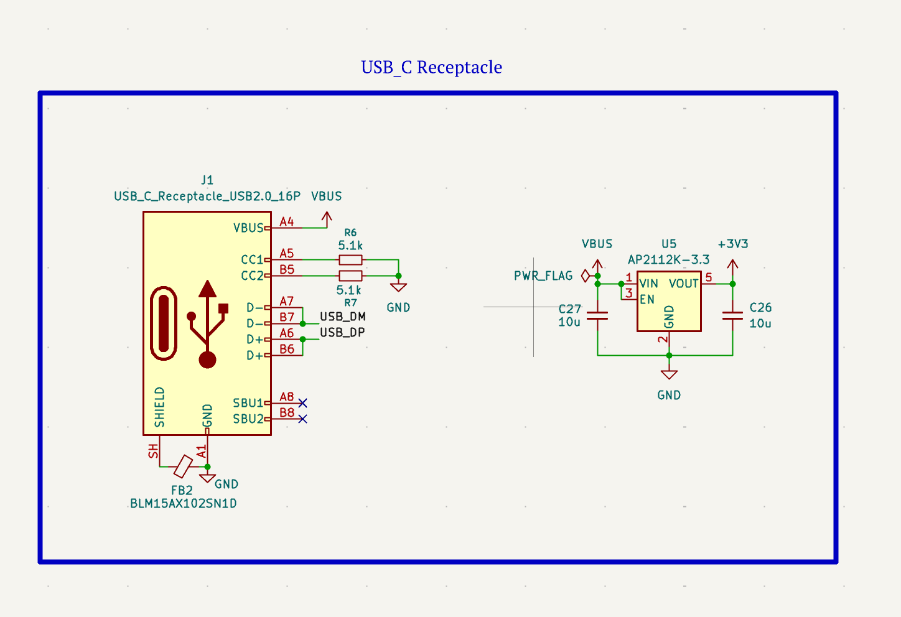
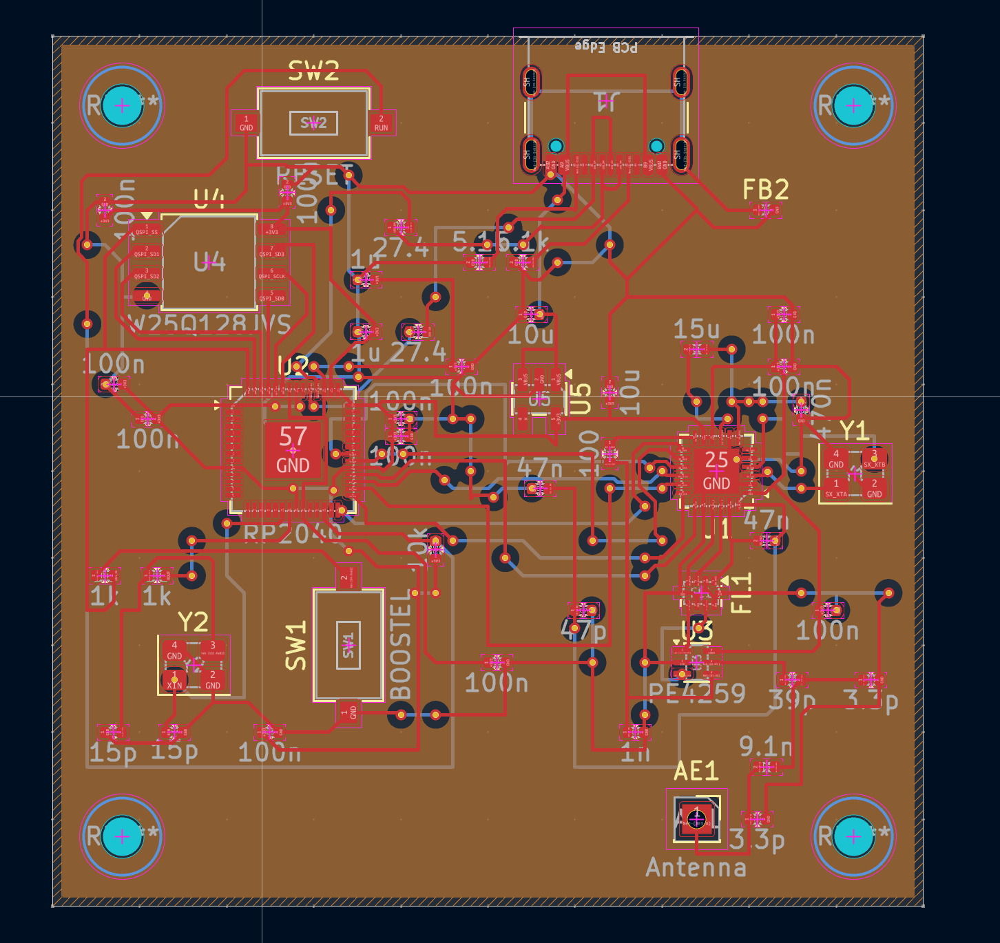
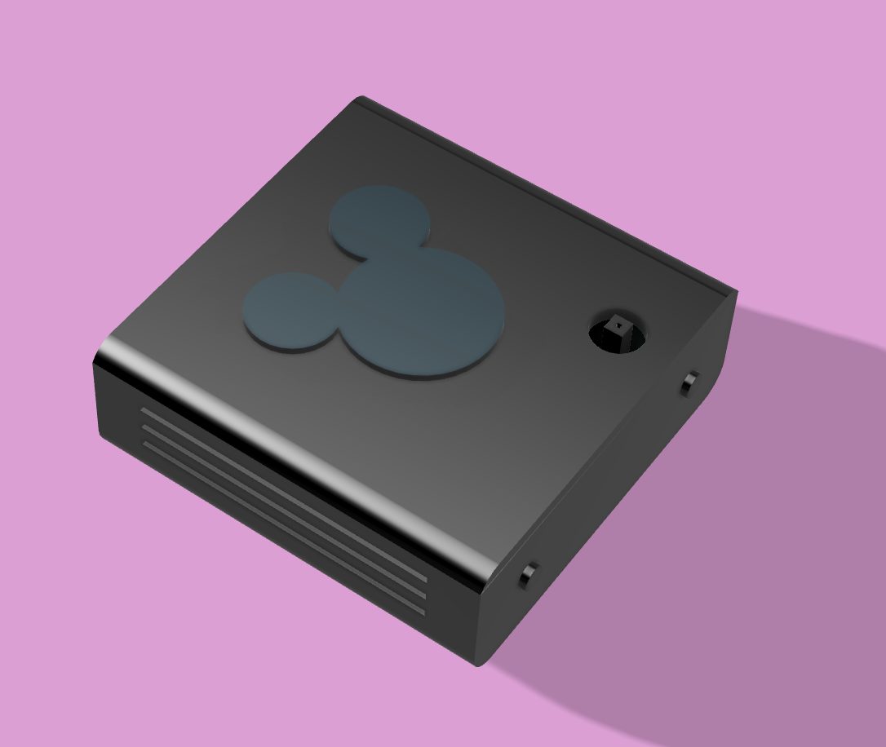
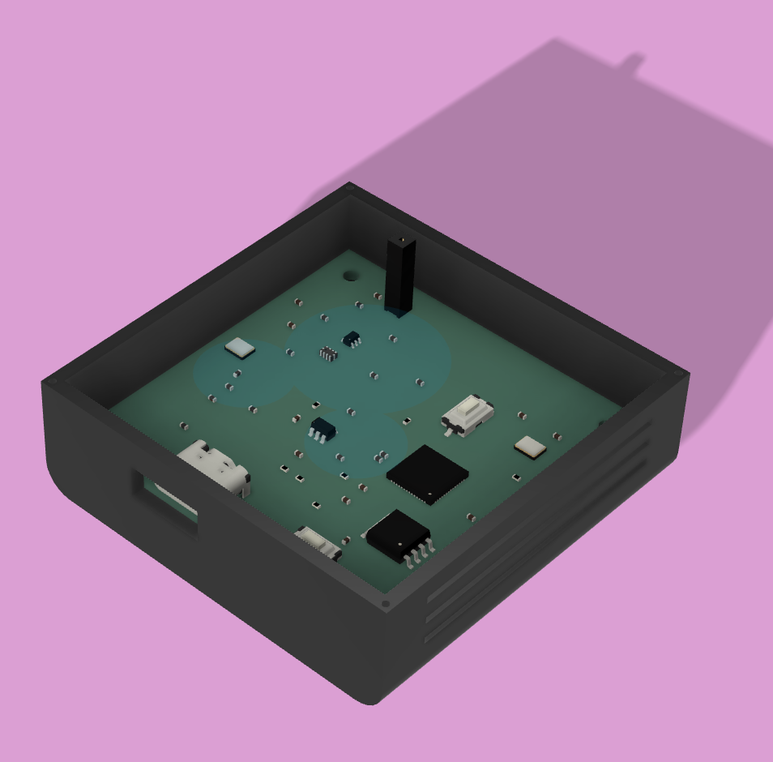

# LoRaPuck 

okay so this is my LoRa board. it's a little 4-layer PCB that sends data through the air with no wifi, no cell towers, no internet, nothing. just radio waves. and LoRa is made for long range, so two of these can talk to each other from kilometers away.

## why i made this

i wanted to know how radio boards actually work. also i wanted to make something cool.....so i made it using the guide https://blueprint.hackclub.com/starter-projects/lora.

## project showcase

  

## specs

- **PCB size:** 50 mm x 50 mm
- **frequency:** 915 MHz.
- **layers:** 4. top and bottom are for signals, inner 1 is a solid ground plane, inner 2 is the 3.3V plane
- **RF traces:** CPWG (coplanar waveguide with ground) at the width i calculated for 50 ohm, using KiCad's calculator
- **ground pours:** everywhere there's free space, to cut down noise
- **via fences:** i lined the RF section with ground vias and stitched the rest of the board too. noise has nowhere to go
- **header pins:** broken out so you can plug in your own sensors
- **the numbers:** 237 pads, 84 vias, 591 track segments, 74 nets, 0 unrouted. DRC is clean except for the USB footprint warnings (those are normal, i checked)

## how it works

- You plug it in via USB-C. This powers the board and lets you flash your code to the RP2040 microcontroller, which acts as the brain of the whole thing.

- When the RP2040 wants to send a message, it talks to the SX1262 LoRa chip.

- The LoRa chip blasts that data out as radio waves through the antenna (which sticks right out of the 7mm porthole I designed into the top of the case).

- You get a portable little node that can bounce short messages or sensor data over miles without needing Wi-Fi, Bluetooth, or a cell tower.

## schematic

i split it into three blocks so it's easier to read: USB-C, the RP2040, and the RF device.

  

## PCB layout

i laid out the MCU, radio and USB as their own little sections first, then put them together, keeping the RF part as far from the noisy stuff as i could. decoupling caps are right next to the pins they belong to, and the inductor on the radio's switching regulator got fat traces because it switches fast.

## the case

i designed the case in Fusion 360. it's two parts you can 3D print: a bottom shell with four posts for the PCB to sit on, and a lid with a Mickey-head inlay on top (because why not). there are three vent slots on the side and a hole for the USB-C port.

 

## firmware

the firmware is vibecoded yet...once the hardware part is done,i'll work on it.

## BOM
| Part | Description | Qty | Unit Cost | Total Cost | Vendor |
| ---- | ----------- | --- | --------- | ---------- | ------ |
| PCB | 4-layer PCB | 1 | $20.10 | $20.10 | [zbotic.in](https://zbotic.in/pcb-manufacturing/) |
| SX1262IMLTRT | LoRa RF transceiver | 1 | $5.52 | $5.52 | [robu.in](https://robu.in/product/sx1262imltrt-semitech-300kbps-general-purposeism1ghz-spi-qfn-24-ep4x4-rf-transceiver-ics-rohs/) |
| RP2040 | Main microcontroller | 1 | $0.68 | $0.68 | [robu.in](https://robu.in/product/raspberry-pi-rp2040/) |
| PE4259 | RF antenna path switch | 1 | $0.60 | $0.60 | [sharvi](https://sharvielectronics.com/product/4259-63-spdt-high-power-ultracmos-10mhz-to-3-0ghz-rf-switch-ic-sc-70-6-package/) |
| W25Q128JVS | 128-Mbit SPI flash memory | 1 | $2.02 | $2.02 | [sharvi](https://sharvielectronics.com/product/w25q128-flash-chip-128mbit-16mb-soic-8-package/) |
| AP2112K-3.3 | 3.3 V voltage regulator | 1 | $0.22 | $0.22 | [sharvi](https://sharvielectronics.com/product/ap2112k-3-3trg1-3-3v-600ma-ldo-voltage-regulator-sot-25-5-package/) |
| USB-C receptacle (GCT USB4105 family) | USB power and USB 2.0 data connection | 1 | $0.21 | $0.21 | [sharvi](https://sharvielectronics.com/product/16-pin-c-type-usb-connector-smd-package/) |
| PTS636Sx25SMTRLFS family tactile switch | BOOTSEL and RESET buttons | 4 | $0.49 | $1.96 | [robu.in](https://robu.in/product/pts636sk25smtrlfs-ck-rectangle-button-50ma-standing-paste-spst-normally-open-250gf-12v-tactile-switches-rohs/) |
| Antenna | LoRa RF transmission and reception | 1 | $0.84 | $0.84 | [robu.in](https://robu.in/product/lora-antenna-915mhz/) |
| 32 MHz SMD Crystal | SX1262 RF reference clock | 2 | $0.20 | $0.40 | [sharvi](https://sharvielectronics.com/product/32mhz-10pf-%c2%b110ppm-tolerance-r2520-32-000-10-f-1010-tr-ns8-smd-crystal-2-50mmx2mm-package/) |
| Case | 3D printed body | 1 | $32.00 | $32.00 | [printlegion](https://printlegion.hackclub.com/) |
| Tax & shipping | For the whole order | - | - | $0.00 | - |
| **Grand Total** | | | | **$64.55** | |